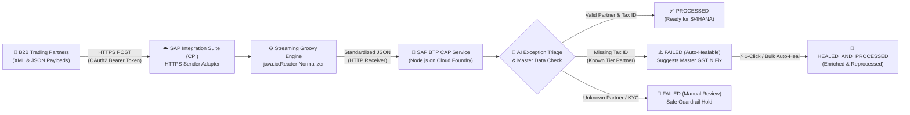

<div align="center">

# ⚡ SAP BTP + Cloud Integration (CPI) — AI Self-Healing B2B Order Hub

**Autonomous Middleware Exception Triage, Schema Normalization & 1-Click Self-Healing Cockpit**

[](https://sap-btp-cpi-self-healing-hub-ajit.cfapps.ap21.hana.ondemand.com)
[](https://44f4b665trial.it-cpitrial03-rt.cfapps.ap21.hana.ondemand.com/http/b2b/orders)
[](https://sap-btp-cpi-self-healing-hub-ajit.cfapps.ap21.hana.ondemand.com/odata/v4/hub/$metadata)
[](https://sap-btp-cpi-self-healing-hub-ajit.cfapps.ap21.hana.ondemand.com/odata/v4/hub/$metadata)

[🚀 Launch Live Cockpit](https://sap-btp-cpi-self-healing-hub-ajit.cfapps.ap21.hana.ondemand.com) • [📡 OData V4 Metadata](https://sap-btp-cpi-self-healing-hub-ajit.cfapps.ap21.hana.ondemand.com/odata/v4/hub/$metadata) • [🏗️ Architecture](#️-end-to-end-cloud-architecture)

</div>

---

## 🌐 Live Production Endpoints

| Component | Runtime Environment | Live URL / Endpoint | Auth Mechanism |
| :--- | :--- | :--- | :--- |
| **Executive Self-Healing UI** | SAP BTP Cloud Foundry (`cflinuxfs4`) | https://sap-btp-cpi-self-healing-hub-ajit.cfapps.ap21.hana.ondemand.com | Public Cockpit |
| **CAP OData V4 Backend** | SAP CAP Node.js Service | https://sap-btp-cpi-self-healing-hub-ajit.cfapps.ap21.hana.ondemand.com/odata/v4/hub | REST / OData V4 |
| **B2B Ingestion iFlow** | SAP Integration Suite (Cloud CPI) | `https://44f4b665trial.it-cpitrial03-rt.cfapps.ap21.hana.ondemand.com/http/b2b/orders` | OAuth 2.0 Client Credentials |

---

## 🏗️ End-to-End Cloud Architecture



---

## 💡 Business Problem vs. Autonomous Solution

| Traditional B2B Middleware | AI Self-Healing B2B Hub |
| :--- | :--- |
| ❌ Rigid schema parsers fail when trading partners send mixed XML/JSON formats. | ✅ **Streaming Groovy Normalizer** parses XML & JSON via `java.io.Reader` with zero memory bloat. |
| ❌ Missing master data (e.g., partner Tax ID) halts order processing and requires manual ticket triage. | ✅ **AI Root-Cause Engine** cross-checks SAP BTP Customer Master Data in real time and pinpoints exact fixes. |
| ❌ Operations teams manually edit payloads and re-trigger failed messages in middleware. | ✅ **1-Click & Bulk OData V4 Actions** (`autoHealOrder`, `autoHealAll`) enrich missing attributes and reprocess automatically. |
| ❌ Blind retries risk pushing unverified or fraudulent partner orders into ERP. | ✅ **Smart KYC Guardrails** block un-onboarded partners for manual compliance review while auto-healing trusted tiers. |

---

## 🧠 AI Triage & Self-Healing Matrix

| Scenario | Source Format | Validation Outcome | AI Root-Cause & Recommended Action | Auto-Heal Eligible? |
| :--- | :---: | :---: | :--- | :---: |
| **Verified GOLD Partner** (`Apex Retail`) | `JSON` | `PROCESSED` | Passed CPI & AI checks. Ready for SAP S/4HANA posting. | — |
| **Known Partner, Missing Tax ID** (`Metro Mart`) | `XML` | `FAILED` → `HEALED_AND_PROCESSED` | Detects missing Tax ID; auto-enriches `GSTIN9988` from Customer Master & reprocesses. | ⚡ **Yes (1-Click)** |
| **Un-onboarded Partner** (`Nova Traders`) | `JSON` | `FAILED` | Flags unknown partner not found in Customer Master; mandates KYC onboarding first. | 🔒 **No (Safe Hold)** |

---

## 🛠️ Enterprise Tech Stack

- **Middleware & Integration:** SAP Integration Suite (Cloud Integration / CPI), HTTPS Sender & HTTP Receiver Adapters, OAuth 2.0 Client Credentials Flow
- **Stream Processing:** Memory-safe Groovy Scripting (`java.io.Reader`, `groovy.json.JsonOutput`) compliant with SAP CPI static code checks
- **Backend & Domain Model:** SAP Cloud Application Programming Model (CAP / Node.js), CDS Data Modeling (`db/schema.cds`), Custom OData V4 Actions (`srv/hub-service.cds`)
- **Database & Persistence:** SQLite / SAP HANA-ready CDS persistence with automated CSV master data seeding
- **Frontend Operations Cockpit:** Real-time auto-syncing Executive Dashboard (`app/index.html`) with live KPI counters & one-click remediation
- **Cloud Runtime:** SAP Business Technology Platform (BTP) Cloud Foundry (`cflinuxfs4`, `nodejs_buildpack`)

---

## 🧪 Sample B2B Ingestion Payloads

### 1. XML Partner Order (Triggers AI Tax ID Self-Healing)
```xml
<Order>
  <orderId>ORD-CPI-9001</orderId>
  <customerName>Metro Mart</customerName>
  <amount>62000</amount>
  <taxId></taxId>
</Order>
```

### 2. JSON Partner Order (Clean Straight-Through Processing)
```json
{
  "orderId": "ORD-6020",
  "customerName": "Apex Retail",
  "amount": 24500,
  "taxId": "GSTIN1234"
}
```

---

## 📂 Repository Structure

```text
CPI_Self_Healing_Hub/
├── app/                  # Real-Time Executive Self-Healing Cockpit UI
├── db/
│   ├── data/             # Master Data CSV seeds (Customers & Initial Orders)
│   └── schema.cds        # CDS Entities (Orders, Customers)
├── srv/
│   ├── hub-service.cds   # OData V4 Service & Custom Self-Healing Actions
│   └── hub-service.js    # AI Exception Triage & Auto-Heal Remediation Logic
├── mta.yaml              # SAP BTP Multi-Target Application Descriptor
├── package.json          # CAP Node.js Dependencies & Build Config
└── README.md             # Architecture & Live Deployment Documentation
```

---

<div align="center">

**Architected & Deployed on SAP BTP by [Ajit Babu Kakumanu](https://github.com/nani26-begin)**

</div>